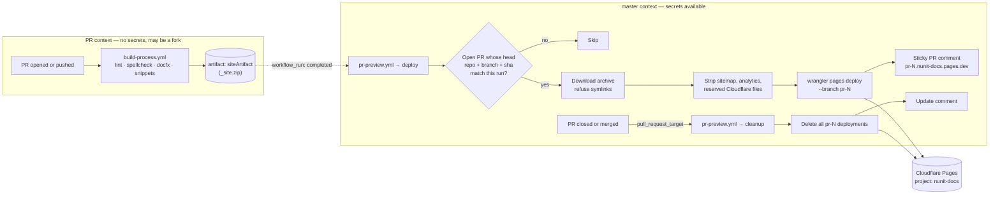

# Pull Request Previews

Every pull request to this repository gets a live preview of the docs site, so authors and reviewers can see rendered changes before merging. This document describes how that works, how it is secured, and what to do when something goes wrong.

Background and decision record: [nunit/docs#1264](https://github.com/nunit/docs/issues/1264).

## What contributors see

* After the build succeeds, a bot posts **one** comment on the PR containing the preview link. The same comment is edited on every later push; it is never duplicated.
* The link has the form `https://pr-<number>.nunit-docs.pages.dev` and stays the same for the life of the PR. It always shows the latest successful build. The comment also includes a per-commit URL for pinning a specific build.
* Previews work for PRs from forks.
* When the PR is closed or merged, the preview is deleted and the comment is updated to say so.
* Previews are served with an `X-Robots-Tag: noindex` header, contain no sitemap, and have Google Analytics removed, so they never show up in search results or production analytics.

## How it works

The build and the deployment are deliberately split into two workflows. GitHub does not give repository secrets to `pull_request` runs from forks, which is what broke the previous Netlify-based preview ([#983](https://github.com/nunit/docs/issues/983)). A `workflow_run` workflow runs in the context of `master` and therefore has the secrets regardless of where the PR came from. The price of that privilege is that it must treat everything the PR build produced as untrusted.



### The workflows

| File | Trigger | Runs with secrets? | Purpose |
| --- | --- | --- | --- |
| `.github/workflows/build-process.yml` | `pull_request`, `push` to `master` | No (on PRs) | Lint, spellcheck, build the site with DocFX, test snippets, upload `siteArtifact`. Unchanged by the preview feature. |
| `.github/workflows/pr-preview.yml` (`deploy` job) | `workflow_run` on build completion | Yes | Deploy the artifact to Cloudflare Pages and post the sticky comment. |
| `.github/workflows/pr-preview.yml` (`cleanup` job) | `pull_request_target: closed` | Yes | Delete the PR's preview deployments and update the comment. |
| `.github/workflows/cloudflare-token-expiry.yml` | Daily schedule, manual | Yes | Open an issue when the Cloudflare token is within 7 days of expiry or has stopped working. |

### Behaviour details

* **Which PR gets deployed** is decided from the triggering run's `head_repository`, `head_branch` and `head_sha`, which GitHub sets. The job looks up open PRs with that head via the GitHub API and deploys only if the PR's *current* head sha equals the run's sha. This means a build for a commit that has since been superseded is skipped, and a build that finishes after the PR was closed is skipped.
* **Concurrency.** The `deploy` and `cleanup` jobs for the same PR head share one concurrency group with `cancel-in-progress: false` and `queue: max`, so jobs run one at a time in arrival order and pending jobs are queued rather than evicted. Two deploys cannot interleave, a late deploy cannot race a cleanup, and a cleanup that is waiting behind a running deploy is never dropped. Queued deploys for commits that have since been superseded simply skip when their turn comes.
* **Cleanup** collects every deployment for the `pr-<number>` branch across all API pages first, then deletes them. The Cloudflare branch itself disappears once it has no deployments.

## Security rules

The `pr-preview.yml` workflow runs with secrets and is triggered by untrusted PRs. A PR can modify `build-process.yml`, so **anything in the artifact is attacker-controlled**. The workflow is written to these rules; keep them when changing it.

1. **Never check out or execute PR code** in `pr-preview.yml`. It downloads the artifact into `$RUNNER_TEMP`, manipulates static files, and uploads them. Nothing more.
2. **Never trust artifact contents for control decisions.** The target PR number comes from GitHub run metadata, not from the artifact.
3. **Reject non-regular files.** The job fails if the extracted tree contains anything other than plain files and directories. Wrangler follows symlinks, so a symlink to a runner file could otherwise be published.
4. **Delete reserved Cloudflare files** (`_worker.js`, `functions/`, `_routes.json`, `_redirects`, `_headers`) from the upload root so PR content cannot ship Pages Functions or override headers such as `noindex`.
5. **Minimal permissions.** The workflow starts from `permissions: {}` and each job grants only what it needs.

If you need to add a step that does more than move static files, stop and reconsider the design first.

## Hosting

* **Provider:** Cloudflare Pages (free plan), direct upload via Wrangler. Unlimited active preview deployments; limits are 20,000 files and 25 MiB per file per deployment. The site is roughly 4,400 files and 100 MB.
* **Cloudflare account:** `NUnit`. Core team members hold the credentials.
* **Pages project:** `nunit-docs`. Production branch is `master`, which the preview workflow never deploys to, so `nunit-docs.pages.dev` stays empty and every `pr-<number>` deployment is a *preview* deployment. Cloudflare adds `X-Robots-Tag: noindex` to all preview deployments automatically.
* **URL shape:** `https://pr-<number>.nunit-docs.pages.dev` (branch alias, latest build) and `https://<hash>.nunit-docs.pages.dev` (one specific build).
* **Clean URLs:** Pages redirects `/page.html` to `/page` with a 308. DocFX's scripts re-append `.html` before matching the table of contents, so navigation highlighting still works. The archived NUnit 2.x pages use root-relative asset paths, which is fine because each preview is served at its own domain root.

## Secrets and the API token

Two repository secrets are required:

| Secret | Value |
| --- | --- |
| `CLOUDFLARE_ACCOUNT_ID` | The NUnit account ID (not sensitive, but kept as a secret for convenience). |
| `CLOUDFLARE_API_TOKEN` | An **account-owned** API token with exactly one permission: **Account → Cloudflare Pages → Edit**, scoped to the NUnit account. Nothing else is needed; this covers deploying, listing and deleting deployments, and the token-verify call used by the expiry check. |

The token has an expiry date. `cloudflare-token-expiry.yml` reads that date from Cloudflare's token-verify endpoint every day and opens an issue titled *"Cloudflare API token for PR previews needs rotating"* when it is within 7 days of expiring or no longer active. Nothing in the workflow needs editing when the token changes.

### Rotating the token

1. In the NUnit Cloudflare account, create a new API token with the single permission above and a sensible expiry.
2. Update the `CLOUDFLARE_API_TOKEN` repository secret.
3. Run the *Cloudflare token expiry check* workflow manually from the Actions tab and confirm it reports the new expiry.
4. Revoke the old token in Cloudflare and close the issue.

## Troubleshooting

**No preview comment appeared on a PR.**

* Check that the *NUnit Documentation Build Process* run for the PR succeeded. The preview only deploys after a green build.
* Open the Actions tab, select the *PR Preview* workflow, and find the run whose trigger matches the PR's build. The first step logs why it skipped, if it did (usually: a newer commit was pushed before this build finished, so the newer build will post instead).
* If the deploy step failed with an authentication error, the token has probably expired or been revoked. Check for an open token-rotation issue and follow the rotation steps above.

**The preview is stale.** The alias always points at the most recent *successful* deploy. If the latest build failed, the alias still shows the previous build. The comment shows which commit it was built from.

**A preview survived its PR being closed.** The cleanup job runs on `pull_request_target: closed`. Check its run in the Actions tab. To remove deployments by hand, a core team member can run:

```bash
# List preview deployments and their branches
npx wrangler pages deployment list --project-name nunit-docs --environment preview
# Delete one
npx wrangler pages deployment delete <deployment-id> --project-name nunit-docs --force
```

**Testing a local build against the real project.** Core team members with the token can upload a local build to a throwaway branch (never to `master`):

```bash
docfx docs/docfx.json
CLOUDFLARE_API_TOKEN=... CLOUDFLARE_ACCOUNT_ID=... \
  npx wrangler pages deploy docs/_site --project-name nunit-docs --branch pr-0 --commit-dirty=true
```

## Known limitations

* `workflow_run`, `pull_request_target` and `workflow_dispatch` always execute the workflow definition from `master`. Changes to `pr-preview.yml` or the expiry check therefore cannot be tested from the PR that makes them; they take effect once merged.
* Previews are public. Anyone with the link can view them, which is the intended behaviour for documentation.
