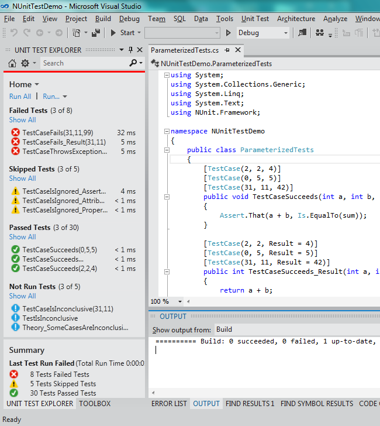

# Usage

In preparation for using the test adapter, make sure that the Unit Test Explorer is shown in your window. If you don't
see it, use the menu ( Test | Windows | Test Explorer ) to show it and position the window where you would like it
within Visual Studio.

When you initially open a solution, no tests will be displayed. After compiling the assemblies in the solution, Visual
Studio will interact with the NUnit Test Adapter to discover tests and a list of them will be shown in the Test
Explorer.

Click on Run All in the Test Explorer to run all the tests. You may also select one or more tests in the list and run
them by right-clicking and using the context menu. The context menu also contains entries for debugging tests and for
navigating to the source code of a test.

Tests may be grouped by Duration and Outcome under VS2012 RTM and also by Traits and Project using Update 1 or later,
and Class using Update 2 or later.  NUnit translates any Categories and Properties used on your tests to Visual Studio
as Traits.

Tests may be filtered in Visual Studio under Update 1 or later by Trait, Project, Error Message, File Path, Fully
Qualified Name, Output and Outcome. Use the search edit box at the top of the list of tests to specify a filter.

Tests may be organized by play lists in Visual Studio under Update 2 or later. Playlists are more or less equal to the
old test lists from VS 2010.

Parameterized tests will show up as separate test cases for each set of parameters.

## Discovery and execution

Visual Studio distinguishes between *discovering* tests and *running* them, and so does NUnit, but the two
distinctions are not the same. NUnit always builds the complete list of tests, including the arguments of every test
case, when it loads an assembly, and only then runs them. See
[Load Time and Execution Time](xref:loadtimeandexecutiontime) for what that means for your test code. How often that
load happens depends on how the adapter is driven:

* **Visual Studio with real-time test discovery (RTD) enabled.** Test Explorer fills its list from the source code,
  without loading the assembly. When you run tests, one test host starts and loads the assembly once. The adapter
  explores and then runs the same loaded tests.
* **`dotnet test`.** One load per run, as above.
* **Visual Studio with RTD disabled.** Test Explorer asks the adapter to discover the tests, which loads the assembly
  in one test host. Every run then starts a new test host, which loads the assembly again. Load-time code, such as
  `[TestCaseSource]` members, runs twice, in two different processes.
* **.NET Framework test projects.** The NUnit framework runs in its own AppDomain inside the test host. Only test
  events and results cross back to the adapter, as XML.

In practice:

* Never expect state created during discovery to exist during execution. Every load starts from scratch, and nothing
  except the test tree itself survives from one load to the next.
* Data sources must return the same test cases, with the same names, on every load. Otherwise the adapter cannot match
  the tests it discovered with the tests it runs. The [Random](xref:attribute-random) attribute is safe to use: the
  adapter saves the random seed used during discovery and reuses it during execution, so the generated test cases keep
  their names. The [RandomSeed](xref:tipsandtricks) setting lets you fix the seed yourself.
* Data sources run for every test in the assembly on every load, even when you run a single test. The
  [PreFilter](xref:tipsandtricks#prefilter) setting limits discovery to the tests being run.

For settings options, see the [Tips and Tricks](xref:tipsandtricks)
